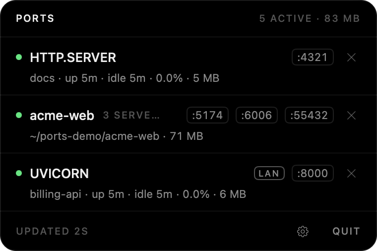
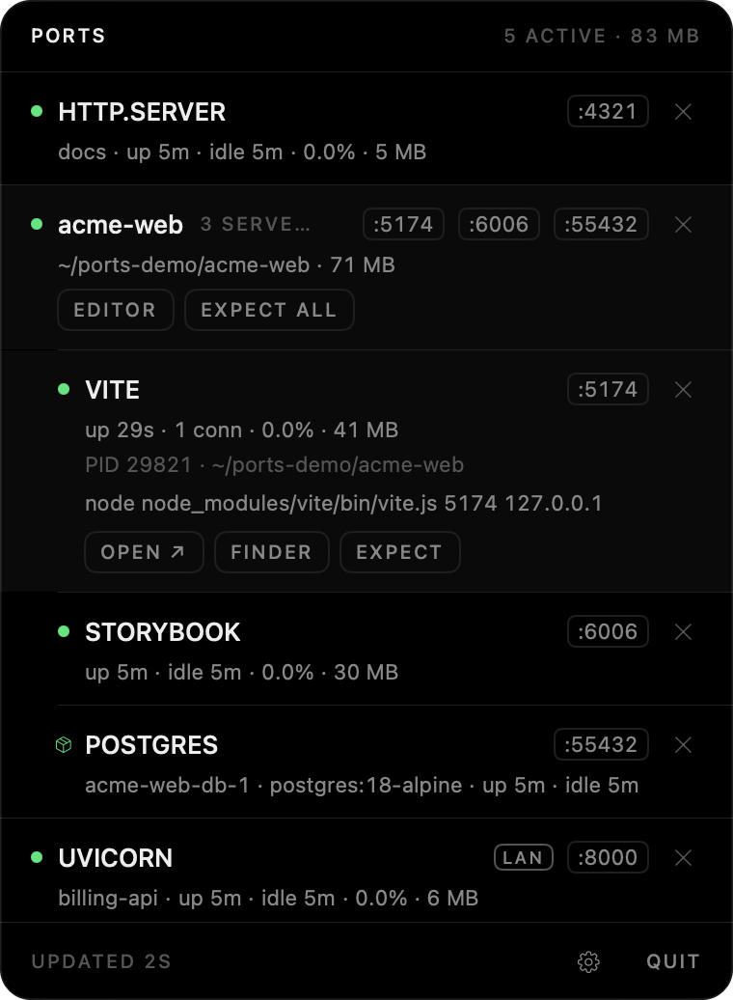
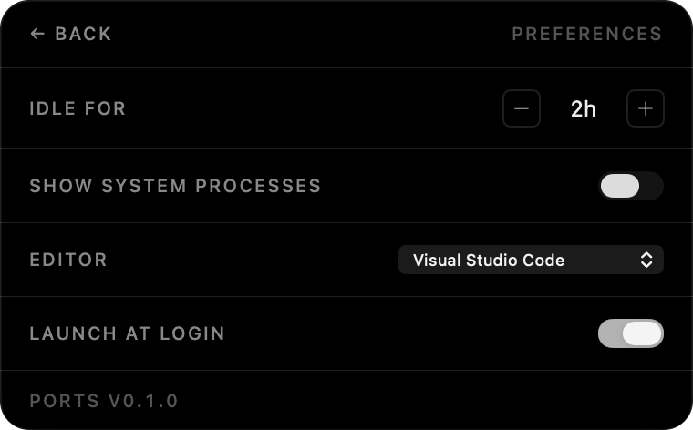

<div align="center">

# Ports

**See every dev server you left running. Kill it in one click.**

A tiny, native macOS menu bar app that shows which processes are listening on which TCP ports,
which project they belong to, whether anyone is still using them, and lets you stop them instantly.

[](#requirements)
[](https://swift.org)
[](https://developer.apple.com/xcode/swiftui/)
[](Package.swift)
[](LICENSE)
[](CONTRIBUTING.md)
<br>
[](https://github.com/httpsgabv/ports/commits/main)
[](https://github.com/httpsgabv/ports)
[](https://github.com/httpsgabv/ports/stargazers)

<br>



</div>

---

## Why

If you juggle side projects, you know the drill: a `vite` from yesterday, a `next dev` from last week, a Postgres
container you forgot about — all quietly eating RAM and CPU, and holding the port you need right now.

Activity Monitor doesn't tell you *which project* a `node` process belongs to. `lsof -i` does, sort of, if you
remember the flags and can read the output. **Ports** puts the answer one click away in your menu bar, and the
icon's counter reminds you that something is still running before you even look.

## Features

| | |
|---|---|
| 🔌 **Every listening port** | All TCP listeners owned by you, refreshed every 5 seconds. No `sudo`. |
| 📁 **Grouped by project** | Processes are grouped by git repository (monorepos included) and named after `package.json`. Three Vite servers become one `acme-web · 3 SERVERS` row. |
| 🏷️ **Knows what it is** | `node …/vite.js` shows up as **VITE**. Also detects Next, Nuxt, Astro, Remix, Storybook, Expo, Webpack, Rails, Django, Uvicorn, Flask, `http.server`, Postgres, Redis, MySQL and Mongo. |
| 🐳 **Docker aware** | Published containers show up as their own rows (`POSTGRES`, `REDIS`…) instead of an opaque `com.docker.backend`, grouped with their compose project. Killing the group stops the **whole stack**, internal containers included. Tested with Docker Desktop; OrbStack and Colima are detected by runtime name but untested. |
| 💤 **Idle, not just old** | A server with an open browser tab (HMR socket) or a connected app is *in use*. Rows show `up 3h · 2 conn` or `up 3h · idle 2h`, and only truly idle ones turn amber. |
| 🔢 **Counter in the menu bar** | The icon shows how many dev servers are running and turns amber when one has been idle too long. |
| ☠️ **One-click kill** | `SIGTERM`, then `SIGKILL` after 3s if needed. Kill one process or the whole project. |
| ✋ **Expected processes** | Mark the Postgres you *want* running as **expected**: it stops counting and never turns amber, but stays visible and killable. |
| 📡 **LAN warning** | A `LAN` chip flags servers bound to `*` / `0.0.0.0` — reachable by anyone on the same café Wi-Fi. |
| ⚡ **Quick actions** | Open `localhost:<port>` in the browser, reveal the project in Finder, or open it in Cursor, VS Code, Zed, Windsurf, Sublime Text or Xcode. |
| 🪶 **Featherweight** | ~15 MB of memory and well under 1% CPU while idle. Zero third-party dependencies. |

## Screenshots

<div align="center">
<table>
<tr>
<td align="center"></td>
<td align="center"></td>
</tr>
<tr>
<td align="center"><sub><b>Project expanded</b> · Vite with a live connection, Storybook, and the project's Postgres container</sub></td>
<td align="center"><sub><b>Preferences</b> · inline, no extra window</sub></td>
</tr>
</table>
</div>

## Requirements

- macOS **26** (Tahoe) or later
- Xcode **26+** / Swift **6.2+** command line tools (to build from source)

## Install

Ports is distributed as source. Build and install it in about a minute:

```bash
git clone https://github.com/httpsgabv/ports.git
cd ports
./scripts/bundle.sh --install
open /Applications/Ports.app
```

`bundle.sh` builds a release binary, assembles `Ports.app`, signs it ad-hoc for your machine, and with
`--install` copies it to `/Applications` (required for *Launch at login*).

> [!NOTE]
> Ports lives only in the menu bar: there is no Dock icon and no window to close. Quit it from the popover
> (`QUIT` or <kbd>⌘</kbd><kbd>Q</kbd>).

## Usage

Click the menu bar icon to open the popover.

```
● VITE                                   :5174   ×      ← kind (or process name), ports, kill
  acme-web · up 3h 05m · 1 conn · 0.3% · 41 MB          ← project, uptime, activity, CPU, memory
```

| Action | How |
|---|---|
| Show details (PID, full command, path) | Click the row |
| Open in browser | Click a `:port` chip, or **OPEN ↗** |
| Reveal in Finder / open in editor | **FINDER** / **EDITOR** in the expanded row |
| Kill a process | **×** |
| Kill a whole project (processes + containers) | **×** on the project row |
| Stop counting a process | **EXPECT** (undo it from the **EXPECTED** section at the bottom) |
| Preferences | **⚙** or <kbd>⌘</kbd><kbd>,</kbd> |

### Preferences

| Setting | Default | |
|---|---|---|
| **Idle for** | 2h | How long a server can go without inbound connections before it turns amber. |
| **Show system processes** | Off | Shows daemons and GUI apps (Control Center, Raycast…), hidden by default. |
| **Editor** | First installed | Cursor → VS Code → Zed → Windsurf → Sublime Text → Xcode. |
| **Launch at login** | Off | Uses `SMAppService`; the app must be in `/Applications`. |

## How it works

Ports shells out to the tools macOS already ships, parses their output with pure, tested functions,
and caches aggressively so the menu bar counter costs almost nothing:

| Data | Source |
|---|---|
| Listening ports + inbound connections | `lsof -nP -iTCP -sTCP:LISTEN,ESTABLISHED` (one spawn per tick) |
| Start time, CPU, memory, executable | `ps -o pid=,lstart=,%cpu=,rss=,comm=` |
| Full command line | `ps -o pid=,command=` |
| Working directory → project | `lsof -d cwd`, then the nearest `.git` and `package.json` |
| Containers | `docker ps`, only when a container runtime is listening |

While the popover is closed, only `lsof` runs every 5s; details are fetched just for **new** PIDs. Opening
the popover triggers a full refresh so CPU and memory are live while you look.

### Safety

- **No elevated privileges.** Ports never uses `sudo` and can only signal your own processes.
- **PID reuse protection.** Before sending any signal, the process start time is re-read; if the PID now belongs
  to a different process, nothing is sent.
- **Never kills the runtime.** Containers are stopped with `docker stop`; the Docker / OrbStack process itself is
  never signaled. PID 1 and Ports itself are refused.
- **Nothing leaves your machine.** No network calls, no telemetry, no analytics.

## Development

```bash
swift build               # debug build
swift test                # 57 tests: parsers on real fixtures + integration with real sockets/processes
./scripts/bundle.sh       # build/Ports.app
```

Docker integration tests run only when Docker is up and `caddy:2-alpine` is available locally; otherwise they are skipped.

```
Sources/
  PortsCore/    pure, testable logic: scanning, parsing, identity, Docker, kill (no UI)
  Ports/        SwiftUI app: menu bar, store, views, theme
Tests/
  PortsCoreTests/
specs/          numbered specifications (00–10)
tasks/          per-spec plan.md + todo.md
scripts/        bundle.sh, screenshots.sh
```

<details>
<summary><b>Retaking the README screenshots</b></summary>

`scripts/screenshots.sh` captures only the popover window (requires Screen Recording permission for your terminal).
Launch a build that shows only demo projects, so your real projects stay out of the images:

```bash
./scripts/bundle.sh
open -n --env PORTS_DEMO_ROOT="$HOME/ports-demo" build/Ports.app
./scripts/screenshots.sh main expanded preferences
```

For each name it waits for the popover to open, counts down 10 seconds, captures and plays a sound.

</details>

<details>
<summary><b>Debugging a kill</b></summary>

Every kill is logged:

```bash
/usr/bin/log show --last 10m --predicate 'subsystem == "dev.gabriel.ports"' --style compact
```

</details>

This project was built **spec first**: every module has a spec in [`specs/`](specs/) and a plan + checklist in
[`tasks/`](tasks/) (written in Portuguese), indexed by the [capability map](CAPABILITY-MAP.md).

## Known limitations

- **TCP only.** UDP listeners are not shown.
- **Your processes only.** Servers running as root or another user are invisible without `sudo`, by design.
- **No CPU/memory for containers.** `docker stats` is too slow to poll.
- **Kill has no confirmation.** It's one click by design, which also means one accidental click.

## Contributing

Contributions are welcome. Read [CONTRIBUTING.md](CONTRIBUTING.md) for the workflow, code style and design rules.

## License

[MIT](LICENSE) © Gabriel Bauer
